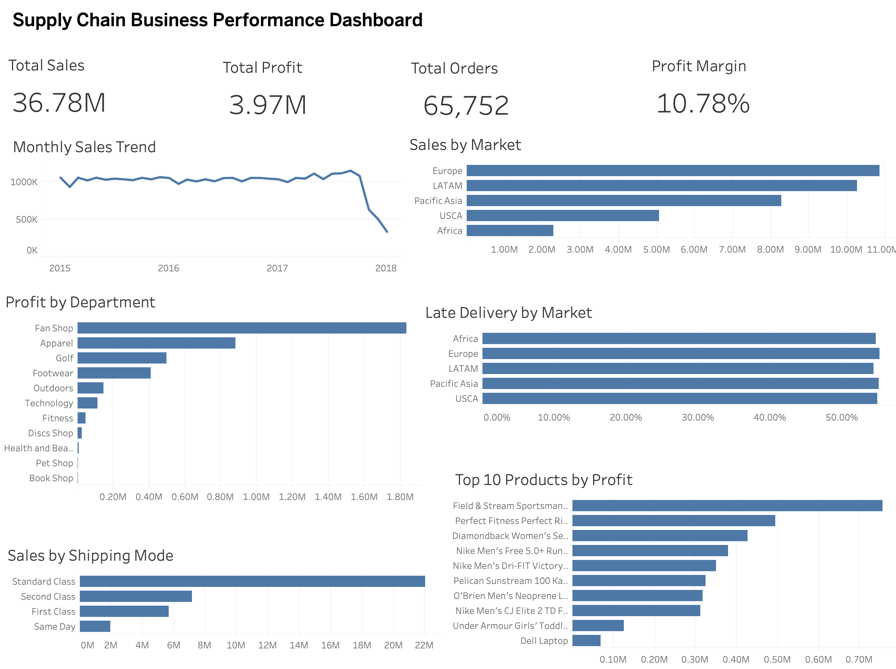
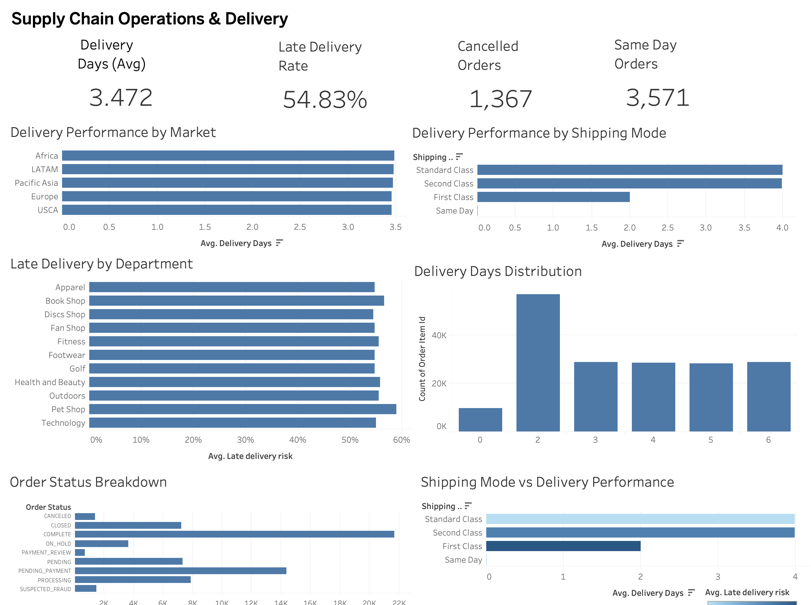

# Supply Chain Business Performance & Operations Intelligence

An end-to-end data analytics project exploring supply chain performance, profitability, shipping operations, and delivery delays using Python, PostgreSQL, SQL, and Tableau Public.

## Project Overview

This project analyzes the DataCo Smart Supply Chain dataset to understand business performance and identify operational areas that require attention.

The workflow covers data cleaning, database loading, SQL analysis, dashboard development, root-cause investigation, and business recommendations.

## Business Objectives

- Evaluate overall sales and profitability.
- Compare performance across markets and departments.
- Analyze customer segments and product performance.
- Investigate shipping and delivery performance.
- Identify patterns in late deliveries and cancellations.
- Investigate loss-making products and discount-profit relationships.
- Translate analytical findings into business recommendations.

## Dataset

- **Dataset:** DataCo Smart Supply Chain Dataset
- **Original records:** 180,519
- **Original columns:** 53
- **Cleaned records:** 180,519
- **Cleaned columns:** 55
- **Order date range:** January 2015 – January 2018
- **Unit of analysis:** One row represents an order item.

CSV data files are excluded from this public repository. Place the source and cleaned CSV files in the local `data/` folder before running the scripts, and check the dataset's terms before redistributing it.

## Technology Stack

| Tool | Purpose |
|---|---|
| Python | Data processing |
| Pandas | Data cleaning and transformation |
| NumPy | Numerical operations |
| PostgreSQL | Data storage and querying |
| SQL | Business analysis and root-cause investigation |
| Tableau Public | Interactive dashboards |
| Git and GitHub | Version control and project sharing |

## Project Workflow

Raw CSV Data → Python and Pandas data cleaning → PostgreSQL → SQL business analysis → Tableau Public dashboards → Business insights and recommendations

## Key Analysis Areas

- Overall business KPIs
- Market and department performance
- Customer segment analysis
- Product sales and profitability
- Monthly sales and profit trends
- Shipping-mode performance
- Late-delivery patterns
- Order status and cancellations
- Discount levels and profitability
- Product-level loss analysis

## Tableau Dashboards

### Dashboard 1: Supply Chain Business Performance

- Total Sales, Total Profit, Total Orders, and Profit Margin
- Monthly Sales Trend
- Sales by Market
- Profit by Department
- Late Delivery by Market
- Sales by Shipping Mode
- Top 10 Products by Profit

### Dashboard 2: Supply Chain Operations & Delivery

- Average Delivery Days
- Late Delivery Rate
- Cancelled Orders and Same Day Orders
- Delivery Performance by Market and Shipping Mode
- Late Delivery by Department
- Delivery Days Distribution
- Order Status Breakdown
- Shipping Mode vs Delivery Performance

Open `tableau/supply_chain_tablue.twbx` in Tableau to explore the workbook. The workbook may rely on the local cleaned CSV data source; if prompted, reconnect it to `data/cleaned_supply_chain.csv`.

## Preliminary Findings

- Overall sales are approximately **36.78 million**, total profit is approximately **3.97 million**, and profit margin is approximately **10.78%**.
- Late-delivery rates were approximately **54–55%** across markets.
- First Class shipping had an observed late-delivery rate of approximately **95.32%**, compared with approximately **38.07%** for Standard Class shipping.
- Most departments had late-delivery rates clustered around **54–56%**.
- Approximately **18.7% of order items** were loss-making.
- Average profit declined across the observed discount bands from 0–10% to 20–30%.

These are observed relationships in the dataset and do not establish causation.

## Business Recommendations

- Investigate the reasons behind the high observed late-delivery rates for First Class and Second Class shipping.
- Review promised delivery dates, carrier performance, and fulfilment processes.
- Investigate pricing, costs, and discounts for products with high loss rates.
- Monitor delivery performance and profitability using separate KPIs.
- Validate findings with operational context before implementing changes.

## Repository Structure

```text
Supply_Chain_Analytics_Project/
├── data/                 # Local CSV files, excluded from Git
├── documentation/
│   └── project_notes.md
├── python/
│   ├── 01_data_inspection.py
│   └── 02_load_to_postgres.py
├── sql/
│   ├── 01_database_setup.sql
│   └── 02_root_cause_analysis.sql
├── tableau/
│   └── supply_chain_tablue.twbx
├── .gitignore
└── README.md
```

## Setup Notes

1. Create and activate a Python virtual environment.
2. Install the required dependencies, including `pandas`, `sqlalchemy`, `psycopg2-binary`, and `python-dotenv`.
3. Place the source and cleaned CSV files in the local `data/` folder.
4. Create a PostgreSQL database named `supply_chain_analytics`.
5. Create a local `.env` file in the project root with your own connection settings:

   ```env
   DB_USER=your_postgres_username
   DB_PASSWORD=your_postgres_password
   DB_HOST=localhost
   DB_PORT=5432
   DB_NAME=supply_chain_analytics
   ```

6. Run `python python/01_data_inspection.py` to inspect and prepare the dataset, if needed.
7. Run `python python/02_load_to_postgres.py` to load the cleaned dataset into PostgreSQL.
8. Execute the SQL files using your PostgreSQL client.

Never commit `.env`, passwords, access tokens, or private credentials. The `.gitignore` file excludes `.env`, the virtual environment, and CSV files in `data/`.

## Project Status

The core data preparation, SQL analysis, Tableau dashboards, documentation, and initial GitHub publication are complete. Further improvements can include adding dashboard screenshots and expanding the analysis with validated operational context.

## Dashboard Previews

### 1. Supply Chain Business Performance Dashboard



### 2. Supply Chain Operations & Delivery Dashboard

